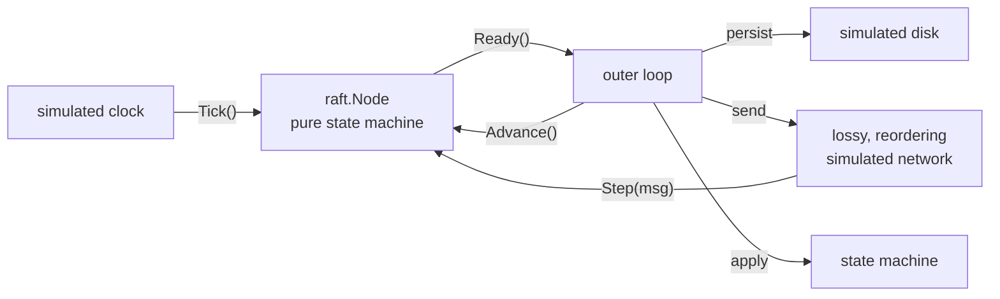

<p align="center">
  
</p>

<p align="center">
  <b>A failure that shows up once in 400 runs should show up every time you ask for it.</b><br>
  <sub>A strongly consistent key-value store in Go, built on Raft written straight from the paper, with the whole cluster running inside a deterministic simulator.</sub>
</p>

<p align="center">
  <sub>
    <a href="#overview">OVERVIEW</a> &nbsp;·&nbsp;
    <a href="#quick-start">QUICK START</a> &nbsp;·&nbsp;
    <a href="#how-it-works">HOW IT WORKS</a> &nbsp;·&nbsp;
    <a href="#how-it-is-checked">HOW IT IS CHECKED</a> &nbsp;·&nbsp;
    <a href="#status">STATUS</a> &nbsp;·&nbsp;
    <a href="#reading">READING</a>
  </sub>
</p>

<br>

<table>
  <tr>
    <td><sub>LANGUAGE</sub><br><b>Go</b></td>
    <td><sub>CONSENSUS LIBRARY</sub><br><b>None. From the paper.</b></td>
    <td><sub>INVARIANTS</sub><br><b>5, after every step</b></td>
    <td><sub>RANDOMISED SEEDS</sub><br><b>12,000 green</b></td>
    <td><sub>TOLERATES</sub><br><b>f failures of 2f+1</b></td>
  </tr>
</table>

## Overview

A cluster of `2f+1` nodes replicates every write through Raft and keeps working through `f` simultaneous failures. Nodes can crash, restart and be cut off from each other without losing a write they acknowledged.

That sentence is easy to write and hard to earn. Most of this project is about earning it.

## Quick start

```bash
make sim            # a 5-node cluster, narrated
make sim SEED=42    # the same run, tick for tick, every time
make test           # unit and scenario tests, race detector on
make chaos          # randomised fault injection
```

`make sim` shows an election, a few writes, a partition that strands the leader in the minority, the heal that rolls back its uncommitted entry, and a leader crash followed by recovery.

## How it works

The Raft core is a **pure, deterministic state machine**. No goroutines, no timers, no network calls. It is driven from outside and only ever returns a description of the work to do.



That design is what makes everything else possible:

- **A whole five-node cluster runs in one goroutine,** under a clock that only moves when the test says so.
- **The network drops, delays, duplicates and reorders** messages on command.
- **Every source of nondeterminism comes from one seed,** so any failure replays byte for byte.

## How it is checked

After every single step of every run, the cluster asserts the five safety properties from the Raft paper:

| | Property | Means |
|:-:|---|---|
| S1 | Election Safety | At most one leader per term |
| S2 | Leader Append-Only | A leader never overwrites its own entries |
| S3 | Log Matching | Logs that agree on an index and term agree on everything before it |
| S4 | Leader Completeness | A committed entry is in every future leader's log |
| S5 | State Machine Safety | No two nodes ever apply different commands at the same index |

On top of that, randomised client histories under partitions and crashes are fed to a linearizability checker.

| Tier | What runs | When |
|---|---|---|
| Unit | Log index maths, term comparison | Every save |
| Scenarios | Split vote, partitioned leader, log divergence | Every save |
| Randomised | 500 seeds × 5,000 steps | Every commit |
| Soak | 10,000 seeds × 50,000 steps | Nightly |
| Real network | Three processes, real sockets, `SIGKILL` | Before calling it done |

> [!NOTE]
> The real-network tier exists because a simulation proves the algorithm, not the plumbing. Real `fsync`, torn writes and socket behaviour are exactly what a simulator replaces.

When the checker finds something, it goes into [`DESIGN.md`](DESIGN.md) with the symptom, the trace, the root cause, the fix, and why the existing tests missed it. The first entry is a good example: the checker itself was wrong.

## Status

**Working:** leader election, log replication and the commit rule, under fault injection, with all five invariants asserted on every step. 12,000 randomised seeds green.

**Not yet:** persistent storage and a real transport (both simulated for now), the key-value state machine, snapshots, linearizable reads, and membership changes. See [ROADMAP.md](docs/ROADMAP.md).

## Reading

| Document | Contents |
|---|---|
| [PRD](docs/PRD.md) | Scope, non-goals, definition of done |
| [Architecture](docs/ARCHITECTURE.md) | Layering, storage format, concurrency |
| [Raft design](docs/RAFT_DESIGN.md) | The algorithm as implemented, and its traps |
| [Testing](docs/TESTING.md) | Simulation, fault injection, linearizability |
| [Invariants](docs/INVARIANTS.md) | The six rules that keep the system deterministic |
| [Glossary](docs/GLOSSARY.md) | Terms that get conflated constantly |
| [Decisions](docs/DECISIONS.md) | What was chosen and rejected |
| [Design](DESIGN.md) | Real bugs, found and fixed |

<sub>
Ongaro and Ousterhout, <a href="https://raft.github.io/raft.pdf"><i>In Search of an Understandable Consensus Algorithm</i></a> &nbsp;·&nbsp;
Ongaro, <i>Consensus: Bridging Theory and Practice</i> &nbsp;·&nbsp;
<a href="https://github.com/anishathalye/porcupine">Porcupine</a>
</sub>
